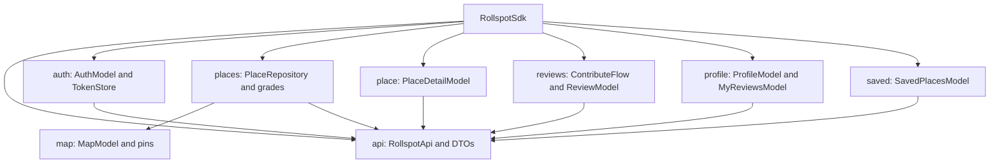
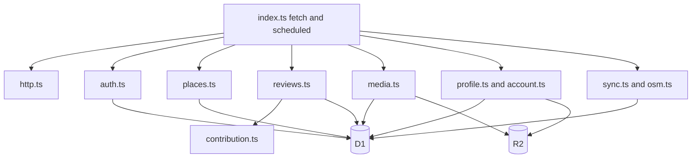

# Component architecture

## Shared mobile component

`RollspotSdk` in
[`Mobile/shared/.../RollspotSdk.kt`](../../Mobile/shared/src/commonMain/kotlin/app/rollspot/shared/RollspotSdk.kt)
is the composition root. Models expose `StateFlow` except `ContributeFlow`, whose mutable state is
republished by native adapters. `RollspotApi` uses Ktor Darwin on iOS and CIO on Android.

| Package | Inputs | Outputs | Failure behavior |
|---|---|---|---|
| `api` | DTOs, token, HTTP request | Decoded DTO or `ApiException` | GET network failures retry at 400/800 ms; writes do not auto-retry |
| `auth` | credentials/ID tokens, native callbacks | `AuthSession` | Validation is local; 401/session absence signs out |
| `places` | location/search/place key | place domain models | OSM attribution is carried with results |
| `map` | viewport, filter, search actions | `MapState` | Error state supports UI retry |
| `place` | Rollspot place key | detail/reviews/photos state | Concurrent sub-loads degrade independently |
| `reviews` | answers and JPEG bytes | `ReviewState`/submitted review | Stable IDs make explicit retries safe |
| `profile`/`saved` | user actions | user-specific state | Optimistic mutations roll back on failure |

## Backend component

The Worker uses ordered pathname checks rather than a router framework. `fetch` catches `HttpError`,
logs unexpected 5xx failures, and emits JSON. `scheduled` invokes `syncDueTiles` with `ctx.waitUntil`.

## iOS component

`RollspotApp` creates app-wide `LanguageManager` and `AuthSessionStore`; `ContentView` presents
`HomeMapView`. `RollspotServices.sdk` constructs the shared SDK with `CloudflareConfig` and
`KeychainTokenStore`.

| Adapter | Shared dependency | Native responsibility |
|---|---|---|
| `MapStore`, `NearbyPlacesService` | `MapModel`, `PlaceRepository` | MapKit annotations/camera |
| `AuthSessionStore` | `AuthModel` | Apple/Google SDK UI and callback handling |
| `PlaceReviewStore` | `PlaceDetailModel` | SwiftUI detail presentation |
| `ReviewService`, bridges | `ReviewModel`, `ContributeFlow` | Swift data/image conversion |
| `ProfileService`, `SavedPlacesService` | profile/saved models | SwiftUI observable state |

State uses `ObservableObject`, `@Published`, `@StateObject`, and SKIE-generated `AsyncSequence`.

## Android component

`RollspotApplication` constructs the shared SDK and restores the session. `MainActivity` hosts
`RollspotApp`, whose `NavHost` defines home, detail, saved, auth, profile/settings, and contribution routes.

| Android adapter | Shared dependency | Native responsibility |
|---|---|---|
| `HomeViewModel` | `MapModel` | Compose state and MapLibre events |
| `PlaceDetailViewModel` | `PlaceDetailModel` | lifecycle-bound detail state |
| `ContributeFlowViewModel` | `ContributeFlow`, `ReviewModel` | picker bytes and wizard UI |
| `AuthViewModel` | `AuthModel` | Credential Manager result |

Most shared flows use `collectAsStateWithLifecycle`. No DI framework, Room, WorkManager, service, receiver,
or notification component is present.
