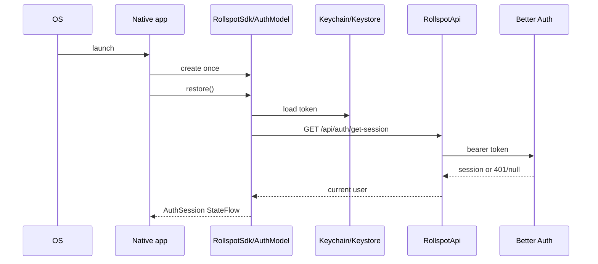
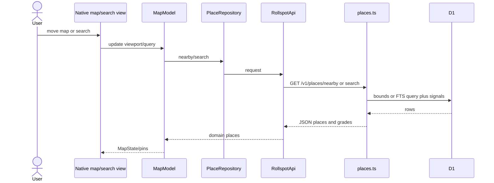
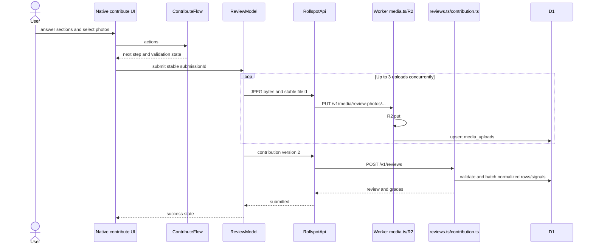
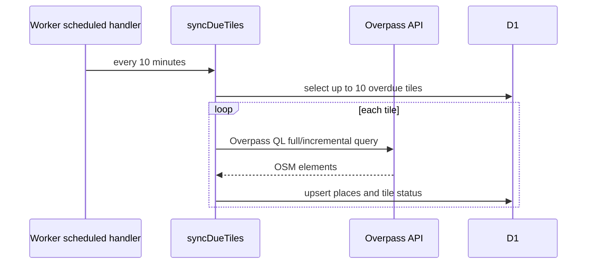

# End-to-end data flows

## Startup and session restoration

iOS starts with `SplashScreenView`; Android restores in `RollspotApplication.appScope`. User-specific saved,
profile, and review state is cleared when the shared session becomes signed out.

## Place discovery and detail

Selecting a Rollspot place creates `PlaceDetailModel`, which concurrently requests the place, venue
photos, review photos, and reviews. MapKit/OpenFreeMap provide map visuals, not the place directory.

## Authentication

Native Apple/Google controls obtain an identity token; `AuthModel` sends it to
`POST /api/auth/sign-in/social`. Email flows use Better Auth email routes and Resend verification.
The returned bearer token is stored in iOS Keychain or encrypted with Android Keystore. Authenticated
requests attach `Authorization: Bearer`.

**Recovery:** client validation prevents malformed forms; provider/server failures become `ApiException`.
Sign-out clears local state even if the remote sign-out fails. A potential stale-token path remains when
`get-session` returns 401/null without `RollspotApi` clearing storage.

## Contribution and persistence

`UNIQUE(user_id, submission_id)` prevents duplicate reviews. Deterministic object keys make repeated
uploads overwrite the same object. Writes are not automatically retried; the UI must reuse the same
submission. D1 and R2 cannot form one transaction, so partial failures can leave orphaned objects.

## Save/profile mutations

Saved-place toggles and profile changes update shared state optimistically and roll back on failure.
The Worker authenticates with `requireUserId`, performs D1 writes, and returns the authoritative model.

## Background place sync

Each populated tile is normally revisited after seven days; empty tiles after 28. Overpass busy responses
stop the run and leave tiles due. There is no alternate provider or lock between manual and cron runs.

## Failure scenarios

| Scenario | Implemented response |
|---|---|
| No network / timeout | Shared GET retries twice; mutations expose error and require explicit retry |
| Auth expired | Auth/session state becomes signed out; protected requests return 401 |
| Server unavailable | `ApiException`; map/detail surfaces retry, some profile/saved paths suppress errors |
| Malformed response | Kotlin serialization fails; `ignoreUnknownKeys` tolerates added fields |
| Third party down | Auth/email operation fails; Overpass delays directory freshness; Android map tiles may be blank |
| Duplicate write | Review ID constraint, deterministic media keys, and idempotent saved PUT/DELETE protect retries |
| Local/remote disagreement | No offline database; reload replaces in-memory state, optimistic writes roll back |
| Realtime/cross-device update | None; clients reload on screen lifecycle or explicit actions |
