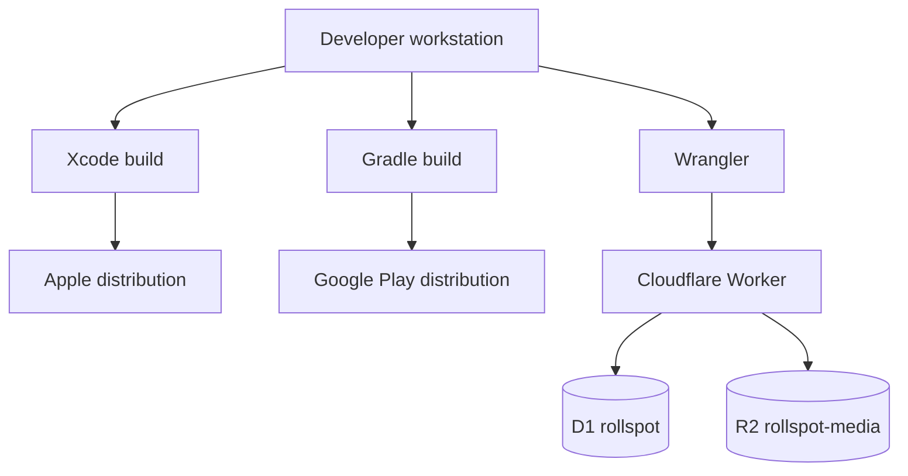

# Deployment architecture



## Verified runtime topology

- Worker name: `rollspot-api`; entry `backend/src/index.ts`.
- Worker compatibility date: `2026-09-01`; `nodejs_compat` enabled.
- D1 binding `DB` targets database name `rollspot`.
- R2 binding `MEDIA` targets bucket `rollspot-media`.
- Scheduled trigger: every ten minutes.
- iOS minimum is 18.0; Android min SDK is 26 and target SDK is 36.

## Deployment interfaces

The repository supplies local commands, not an automated CI/CD pipeline:

```bash
cd backend
npm run db:migrate:remote
npm run deploy
```

Mobile distribution automation is not tracked. App Store Connect/Play Console configuration, signing
certificate storage, Android upload-key custody, rollout policy, and rollback procedures are **Unknown**.

## Configuration injection

- Worker plain variables and bindings are in `backend/wrangler.jsonc`.
- Worker secrets are set through Wrangler and represented by names in `.dev.vars.example`.
- Android local/release values are generated into `BuildConfig` from `Mobile/local.properties`.
- iOS reads Info.plist/build settings and accepts a debug `ROLLSPOT_API_BASE_URL` process override.
- Secrets must not be embedded in either app. Public OAuth client IDs are configuration, not secrets.

## Migrations and rollback

D1 migrations are forward SQL files `0001` through `0005`. The deploy script does **not** run migrations;
the operator must run the remote migration command separately. No down migrations, automated backup,
restore verification, or rollback runbook is tracked. A Worker rollback cannot automatically reverse an
already-applied schema change.
