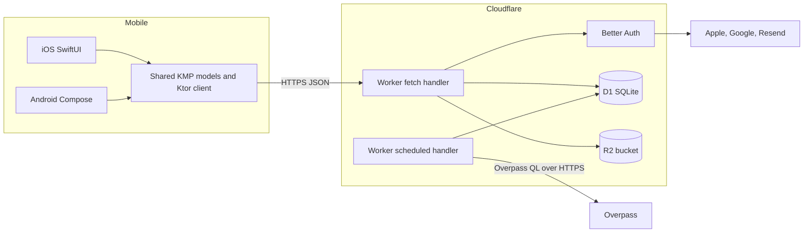

# System overview

## Purpose

Rollspot lets mobility-impaired users discover places and publish structured first-hand observations
about entrances, elevators, toilets, pathways, seating, and parking. V1.1 is one serverless backend,
one shared mobile business-logic module, and two native mobile interfaces.

## Containers

No queue or cache layer exists. JSON responses use `Cache-Control: no-store`; media uses `no-cache`.
The apps do not maintain an offline database and do not receive server-pushed updates.

## Architectural responsibilities

| Component | Responsibility | State owned | Public interface | Main failure effect |
|---|---|---|---|---|
| iOS | SwiftUI screens, MapKit rendering, location, camera/photos, native sign-in | Keychain token, draft in UserDefaults, image cache | Shared models and deep links | One-platform UI or native capability failure |
| Android | Compose screens, MapLibre rendering, location, photo picker, native Google sign-in | Encrypted token, one preference flag, in-memory drafts | Shared models and custom links | One-platform UI, tile, or lifecycle failure |
| Shared KMP | Validation, state machines, API/DTO boundary, retries, grade rules, submission orchestration | In-memory `StateFlow` state | `RollspotSdk` and feature models | Usually affects both apps |
| Worker | Routing, auth, authorization, validation, persistence, public reads, cron | None outside bindings | HTTP `/api/auth/*`, `/v1/*`, `/health` | Both apps lose affected server feature |
| D1 | Relational source of truth | Users, places, reviews, signals, profiles, sync metadata | Worker SQL only | API data failure |
| R2 | Binary object source of truth | JPEG avatars and review photos | Worker binding only | Photo upload/read failure |
| Website | Link landing and iOS association file | Static assets | HTTPS pages and AASA | Shared links fall back or fail |

## Verified patterns

- Manual dependency injection: each app creates one `RollspotSdk`.
- Unidirectional state: shared models expose `StateFlow`; native views send actions.
- Repository/model boundary: `PlaceRepository`, `MapModel`, `PlaceDetailModel`, and other feature models
  sit between UI adapters and `RollspotApi`.
- Idempotent writes: stable review submission IDs, stable media keys, and idempotent saved-place PUT/DELETE.
- Native views/shared logic: platform SDK and presentation remain native; portable decisions belong in KMP.
- Serverless edge runtime: Worker `fetch` and `scheduled` handlers use D1 and R2 bindings.
