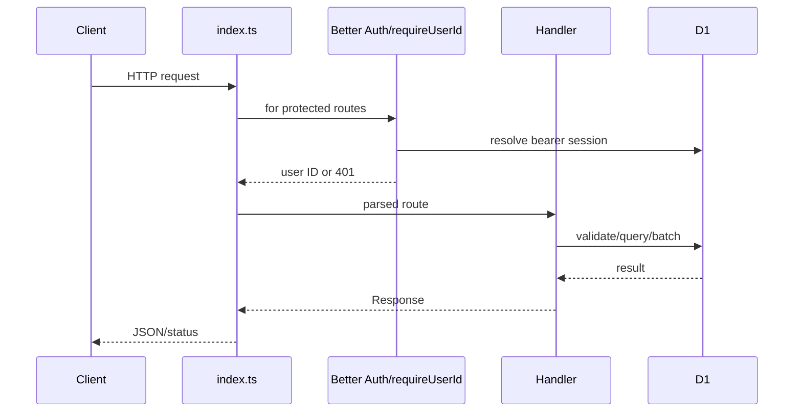

# Backend architecture

## Runtime and lifecycle

The backend is a TypeScript Cloudflare Worker. `backend/src/index.ts` exports:

- `fetch(request, env)`: ordered path/method dispatch, error normalization, HTTP response.
- `scheduled(controller, env, ctx)`: `ctx.waitUntil(syncDueTiles(env))`.

There is no framework router or middleware chain. `http.ts` supplies `HttpError`, JSON responses,
method checks, and JSON-body validation. JSON gets `Cache-Control: no-store`.

## Request path

Expected failures use `HttpError`. Unexpected 5xx errors are logged and returned as JSON. The current
handler exposes `error.message` for unexpected failures (**potential information-disclosure issue**).

## Modules

| Module | Responsibility |
|---|---|
| `auth.ts` | Better Auth, bearer sessions, Apple secret JWT, Resend mail |
| `places.ts` | place search/detail, grades/photos, saved places |
| `reviews.ts` | review create/read/delete, my reviews, public review output |
| `contribution.ts` | V2 payload validation and normalization |
| `media.ts` | deterministic JPEG upload and R2 reads |
| `profile.ts` / `account.ts` | profile/avatar/password-facing state and account deletion |
| `sync.ts` / `osm.ts` | tiled scheduler and Overpass client |
| `env.ts` | bindings and variable/secret names |

## Authentication and authorization

Better Auth owns user/session/account/verification tables. Email/password requires verification; Apple and
Google providers are enabled only when configured. Application handlers use `requireUserId`. Review delete
checks ownership; V2 review photo references check media ownership. Admin sync compares an exact bearer
`ADMIN_TOKEN`.

Public resources: place directory, reviews, review photos, and media-object reads. Protected resources:
write/review operations, profile, saved places, provider list, and account deletion.

## Place sync

The ten-minute cron processes at most ten overdue tiles. First load is full; later queries overlap the
last load by 24 hours. Normal populated tiles are due after seven days, empty tiles after 28. Large
responses/timeouts split tiles down to 0.01 degrees. Overpass 429/502/503/504 stops the run.

No lease prevents concurrent cron/manual work, no alternate Overpass endpoint exists, and no OSM deletion
path removes vanished places.

## R2 consistency

Uploads write R2 then D1 metadata. Deletes generally remove D1 state before deleting R2. D1 and R2 cannot
commit atomically; orphaned objects are possible. No reconciliation or lifecycle job is implemented.

## Configuration and observability

Plain variables/bindings are in `wrangler.jsonc`; secret names are in `.dev.vars.example`.
Logging consists of unexpected request errors, tile failures, and a cron summary. No repository-configured
traces, metrics, alerts, request IDs, crash tracking, or analytics exist. `/health` is liveness only.

## Tests

`npm test` and `npm run check` both run `tsc --noEmit`. No backend runtime test runner or test files exist.
Behavioral coverage comes only from shared KMP tests and the environment-gated live backend journey.
