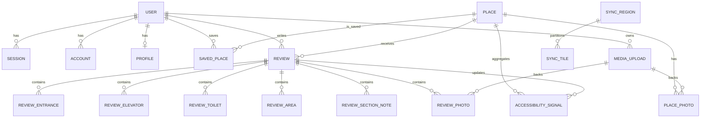

# Data architecture

## Relational model

Actual table names are lowercase/plural as defined in `backend/migrations`.

## Domains and keys

| Domain | Tables | Identity and constraints |
|---|---|---|
| Better Auth | `user`, `session`, `account`, `verification` | text IDs; unique email/session/provider identity |
| Directory | `places`, `places_fts` | integer FTS row ID, stable Rollspot UUID, unique `osm_ref`; lat/lng index |
| Sync | `sync_regions`, `sync_tiles` | region ID plus tile bounds/due state |
| Profile | `profiles` | one row/user; unique pseudonym; JSON-valid mobility aids |
| Saved | `saved_places` | composite `(user_id, place_id)` |
| Reviews | `reviews` and normalized child tables | unique `(user_id, submission_id)`; children cascade |
| Grades | `accessibility_signals` | one current `(place_id, user_id, feature)` signal |
| Media | `media_uploads`, `review_photos`, `place_photos` | R2 object key owns metadata; photo references restrict deletion |

Foreign keys generally cascade user/place/review deletion. Photo rows use `ON DELETE RESTRICT` for media
objects. Domain `CHECK`s protect feature/value codes and JSON validity.

## Access patterns

- Nearby places: latitude/longitude bounds, then distance handling in `places.ts`.
- Search: FTS5 over name/address, maintained by insert/update/delete triggers.
- Place grade: group current accessibility signals by feature/value.
- Public reviews: place/time index; own reviews: user/time index.
- Saved places: user and reverse chronological creation.
- Sync: due-time and region indexes.

## Consistency

Related D1 statements use `DB.batch`; no explicit SQL transactions appear. Review idempotency is enforced
at the schema boundary. R2 plus D1 operations are not atomic. OSM sync upserts by `osm_ref`, retaining the
Rollspot ID so reviews survive imports.

## Data lifecycle

- Account deletion cascades relational user data, then attempts R2 deletion in batches.
- Review deletion cascades normalized rows and signals, then removes linked R2 objects.
- No retention duration, archival, backup/restore, soft delete, or R2 lifecycle policy is defined.
- OSM import has no deletion/tombstone pass.
- Public JSON is uncached; mobile state is memory-bound except token/draft/image caches.

## Potential data issues

- `media_uploads.owner_user_id` has no dedicated index although account deletion filters on it.
- D1/R2 partial failure can leave orphaned media.
- `profiles.show_real_name` is not honored by public review output.
- Incremental OSM upsert cannot reflect deletions from the source.
- Production foreign-key enforcement and backup posture are **Unknown**.
