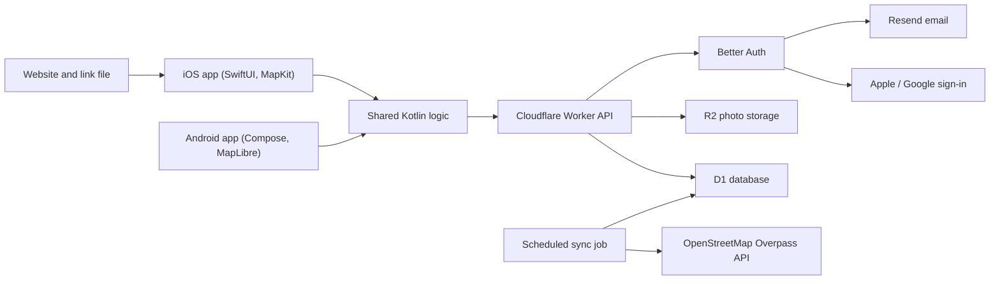

# Rollspot: architecture, failure modes and monthly maintenance

This document explains how Rollspot is built, what can go wrong in each part of the app, and what the
monthly maintenance work involves. It is written for partners and new maintainers, and the shareable PDF
version is `docs/Rollspot-operations-and-maintenance.pdf`. For a code-level description of the backend,
shared module and both apps, see [`v1.1-architecture.md`](v1.1-architecture.md).

## 1. Architecture

Rollspot has one backend and two native apps that share their business logic.

| Part | Technology | What it does |
|------|------------|--------------|
| API | Cloudflare Worker (TypeScript) | Every request from the apps: places, reviews, profiles, sign-in |
| Database | Cloudflare D1 (SQLite) | Places, reviews, accessibility grades, user accounts |
| Photo storage | Cloudflare R2 | Review photos and profile pictures |
| Sign-in | Better Auth, running inside the Worker | Apple, Google, and email/password accounts |
| Email | Resend | Verification and password-reset emails |
| Place directory | OpenStreetMap, via the Overpass API | Source of the malls and places shown on the map |
| Shared app logic | Kotlin Multiplatform module | API calls, sign-in session, form rules, review submission, grade rules |
| iOS app | SwiftUI + Apple Maps (MapKit) | Screens and map rendering on iPhone |
| Android app | Jetpack Compose + MapLibre (OpenFreeMap tiles) | Screens and map rendering on Android |
| Website | Cloudflare Pages | Link landing page and the file that lets iOS open shared links in the app |

**Key design choice:** all business logic (validation, retries, which step comes next) lives once in the
shared Kotlin module. The iOS and Android apps only draw screens. A logic bug is therefore fixed once, not
twice.

**Place data** comes only from Rollspot's own directory. A scheduled job inside the Worker runs every
10 minutes, refreshes a small batch of map areas from OpenStreetMap, and revisits each area about once a
week. The apps never call OpenStreetMap or Apple/Google place search directly, so a slow OpenStreetMap
service does not slow the apps down.

## 2. Critical processes

1. **Finding places.** The app asks the API for places near the user or matching a search. The API answers
   from the database. The map (Apple Maps on iOS, MapLibre on Android) only draws the pins.
2. **Signing in.** The user signs in with Apple, Google, or email and password. Email accounts must confirm
   their address through a link sent by Resend. The app stores a session token in the phone's secure
   storage (Keychain on iOS, Keystore on Android).
3. **Contributing a review.** The user answers questions about entrances, elevators and toilets and adds
   photos. Photos upload first, then the review is submitted. Every submission carries a unique ID, so if
   the connection drops and the user retries, the review is not duplicated.
4. **Opening shared links.** A shared place link opens the website, which hands the user to the app if
   installed. On iOS this relies on a verification file hosted on the website.
5. **Keeping the directory current.** The scheduled sync job pulls new and changed places from
   OpenStreetMap and adds or updates them in the database.

## 3. Failure modes

Each row describes what breaks, what users notice, and what a maintainer checks first.

| Process | What can fail | What users see | First check |
|---------|---------------|----------------|-------------|
| Finding places | API or database unavailable | Map shows an error or no pins | API health endpoint; Cloudflare status and Worker logs |
| Finding places | Directory sync stalled (OpenStreetMap busy or timing out) | Existing places still work; new malls do not appear | Sync logs; run the admin sync manually |
| Finding places (Android) | Map tile provider (OpenFreeMap) down | Blank map background, while pins and lists still load | Tile provider status; switch tile source if prolonged |
| Signing in | Apple or Google credentials expired or misconfigured | That sign-in button fails | Provider keys and client IDs in the backend config |
| Signing in | Email provider (Resend) failing or domain unverified | Sign-up works but no verification email arrives | Resend dashboard; sender domain status |
| Signing in | Session revoked or expired | User is asked to sign in again | Expected behaviour; check only if widespread |
| Contributing | Connection drops during photo upload | Submission fails with a retry option | Retry reuses the same IDs, so nothing is duplicated |
| Contributing | Review rejected by the API (invalid data) | Error message, retry does not help | API logs for the validation error; fix in shared logic |
| Shared links | Website link file or app configuration out of sync | Link opens the website instead of the app | Link file on the website matches the app's team and bundle ID |
| Releases | New Xcode, iOS, Android or Gradle version breaks the build | No user impact until an update is needed | Rebuild both apps; update the shared module toolchain |
| Releases | App store policy change (privacy, account deletion) | Update rejected by Apple or Google | Store review notes; privacy texts and delete-account flow |

**What keeps running without anyone:** the API, database, photo storage, sign-in and the directory sync
all run on Cloudflare automatically. Failures in the table above are rare, but when one happens a person
needs to diagnose it and deploy a fix.

## 4. Monthly maintenance tasks (6–8 hours)

| Task | Typical time | What it involves |
|------|--------------|------------------|
| Health checks | about 1 h | Check the API health endpoint; on both apps, search a place, sign in, open a place, and submit a test review |
| Directory sync check | about 0.5 h | Confirm the sync job is running and recently refreshed areas; re-run it manually if needed |
| Sign-in and credentials | about 0.5 h | Confirm Apple, Google and email sign-in work; act on any key-expiry or rotation notices |
| Dependencies and OS updates | about 2 h | Update libraries with security fixes; rebuild both apps against the latest Xcode/iOS and Android SDK; run the shared tests |
| Store compliance | about 0.5 h | Review Apple and Google policy notices; confirm privacy texts and account deletion still work |
| Links and website | about 0.25 h | Confirm shared links still open the app |
| Bug fixing buffer | 1.5–3 h | Reproduce and fix issues reported by users or found during checks |
| **Total** | **6–8 h** | |

Months with a major iOS or Android release (usually September to October) or a store policy change can use
the upper end of the range. Quiet months may use less.

## 5. Coverage during student breaks

- The platform keeps running on its own. Nothing needs to be started, stopped or watched daily.
- At least one maintainer should remain reachable who can deploy the backend, update credentials and
  publish an app update.
- The routine checks in section 4 can be done in a single session per month, which fits around breaks.
- The 6–8 hour budget remains the planning figure. It covers the unpredictable work (OS updates, credential
  expiry, policy changes, user-reported bugs) that does not pause when students are away.
