# Primary-user contribute flow

Wheelchair user path for contributing a place review. The same sequence runs on iOS and Android. The secondary-user flow is not built yet.

Update this file in the same change whenever the contribute form flow changes (steps, skips, questions, or options).

Step order lives in `Mobile/shared/src/commonMain/kotlin/app/rollspot/shared/reviews/ContributeFlow.kt`. iOS mirrors it in `ContributeReviewFlowView`.

The progress bar is Entrance, Elevator, Toilets, Review. At least one category is required. Sections the user did not pick are skipped. Within a picked section, some answers skip later questions.

```mermaid
flowchart TD
  start[Category pick]
  start --> entrance{Entrance selected}
  entrance -->|yes| entrancePhotos[Entrance photo optional]
  entrancePhotos --> entranceWhere[Where are the accessible entrances]
  entranceWhere --> lobby{Lobby selected}
  lobby -->|yes| lobbyTags[What does the lobby have]
  lobbyTags --> lobbyRamp{Ramp tag}
  lobbyRamp -->|yes| lobbyRampQ[Lobby ramp question]
  lobbyRamp -->|no| lobbyRail{Handrail tag}
  lobbyRampQ --> lobbyRail
  lobbyRail -->|yes| lobbyRailQ[Lobby handrail question]
  lobbyRail -->|no| basement{Basement selected}
  lobbyRailQ --> basement
  lobby -->|no| basement
  basement -->|yes| basementTags[What does the basement have]
  basementTags --> basementRamp{Ramp tag}
  basementRamp -->|yes| basementRampQ[Basement ramp question]
  basementRamp -->|no| basementRail{Handrail tag}
  basementRampQ --> basementRail
  basementRail -->|yes| basementRailQ[Basement handrail question]
  basementRail -->|no| anotherEntrance{Review another entrance}
  basementRailQ --> anotherEntrance
  basement -->|no| anotherEntrance
  anotherEntrance -->|Yes| entrancePhotos
  anotherEntrance -->|No| elevatorGate{Elevator selected}
  entrance -->|no| elevatorGate

  elevatorGate -->|yes| elevatorPhotos[Elevator photo optional]
  elevatorPhotos --> wide[Could you enter the elevator]
  wide -->|not No| space[Space to maneuver]
  space --> buttons[Reachable control buttons]
  buttons --> elevatorWhere[Where is the elevator optional]
  wide -->|No| elevatorWhere
  elevatorWhere --> another{Review another elevator}
  another -->|Yes| elevatorPhotos
  another -->|No| toiletGate{Toilet selected}
  elevatorGate -->|no| toiletGate

  toiletGate -->|yes| toiletPhotos[Toilet photo optional]
  toiletPhotos --> toiletDoor[Door kind]
  toiletDoor --> toiletSeat[Toilet seat]
  toiletSeat --> grab[Grab bars]
  grab --> toiletSpace[Space to maneuver]
  toiletSpace --> sink[Sink]
  sink --> emergency[Emergency aid]
  emergency --> toiletWhere[Where is the accessible toilet optional]
  toiletWhere --> anotherToilet{Review another accessible toilet}
  anotherToilet -->|Yes| toiletPhotos
  anotherToilet -->|No| supplemental[Outdoor pathways seating parking]
  toiletGate -->|no| supplemental
  supplemental --> finalReview[Final review]
  finalReview --> submitted[Submitted]
```

## 1. Category pick

Question: **Help make every visit easier.**

Subtitle: Fill in at least one facility to help others know what to expect.

Categories, in menu order:

- Entrance
- Elevators
- Toilet
- Outdoor Pathways
- Seating
- Parking

Continue stays off until one category is selected.

## 2. Entrance

Shown only when Entrance is selected. Lobby is asked before Basement when both are selected. After that walk, the contributor can review another entrance. Yes starts again at the photo screen. No leaves the section.

| Screen | Question | Continues when |
| --- | --- | --- |
| Photo | Take or upload a photo (optional) | Always |
| Locations | Where can you find the accessible entrances? Multiple places | At least one of Lobby or Basement |
| Tags | What does the lobby have? or What does the basement have? Multiple answers | At least one tag |
| Ramp | Could you push your wheelchair up the ramp without help? | Only if that location's tags include RAMP. One answer |
| Handrail | Could you reach and grip the handrail from your wheelchair? | Only if that location's tags include HANDRAIL. One answer |
| Another | Review another entrance? | Yes or No. Tapping the choice moves on. There is no Continue button |

Lobby tags: RAMP, HANDRAIL, AUTOMATIC DOORS, MANUAL DOORS, SECURITY ASSISTANCE, WHEELCHAIRS AVAILABLE.

Basement tags: ELEVATOR, DISABLED PARKING, RAMP, HANDRAIL, SECURITY ASSISTANCE.

Ramp answers: Yes, With a push, Too steep, Not sure.

Handrail answers: Yes, With effort, No, Not sure.

Ramp and handrail play a looping video. The info button explains slope and landing (ramps) or height and grip (handrails). Choosing Not sure reveals an optional photo box.

Other tags only record that the thing is present. They do not add a screen.

Going back from a restarted photo screen, before anything new is entered, returns to Review another entrance? for the pass just saved. Each saved entrance is submitted as its own entrance report.

## 3. Elevator

Shown only when Elevators is selected. The contributor can review more than one elevator. Each pass is photo, questions, then location. Yes on the last question starts a blank pass. No leaves the section.

| Screen | Question | Continues when |
| --- | --- | --- |
| Photo | Take or upload a photo (optional). Title: Elevator | Always |
| Entrance width | Could you enter the elevator? | One of Yes, No, Not Sure |
| Space to maneuver | Could you turn your wheelchair freely inside? | Skipped when entrance width is No |
| Reachable buttons | Could you reach the control buttons from your wheelchair? | Skipped when entrance width is No |
| Location | Where is the elevator located? (optional) | Always |
| Another | Review another elevator? | Yes or No. Tapping the choice moves on. There is no Continue button |

The three questions use looping videos:

- Entrance width: wide-entrance video. Info sheet **Elevator Entrance** (Width, Level Threshold).
- Space to maneuver: toilet space video. Info sheet **Space to Maneuver**: enough room to enter and turn a full circle without hitting the walls.
- Reachable buttons: buttons video. Info sheet **Control Buttons** (Height, Emergency).

On iOS, Not Sure on a question reveals an optional photo box.

Going back from a restarted photo screen, before anything new is entered, returns to Review another elevator? for the pass just saved.

The review API stores one elevator. Every pass is folded into that report: inaccessible if any pass answered No, `too_small` when a pass failed width or space, and each location plus answers written into the elevator note. Photos from every pass stay on the elevator.

## 4. Accessible toilets

Shown only when Toilet is selected. The contributor can review more than one toilet. Each pass is photo, questions, then location. Yes on the last question starts a blank pass. No leaves the section.

| Screen | Question | Continues when |
| --- | --- | --- |
| Photo | Take or upload a photo (optional). Title: Accessible Toilets | Always |
| Door | What kind of door does the toilet have? | Manual, Sliding, or Automatic |
| Seat | Is the toilet seat easy to transfer to from your wheelchair? | Yes, Too low, Too high, Not sure |
| Grab bars | Are the grab bars within reach of the toilet? | Yes, Positioned awkwardly, No, Not sure |
| Space | Could you turn your wheelchair freely inside? | Yes, No, Not sure |
| Sink | Could you reach the sink? | Yes, No, Not sure |
| Emergency | Could you reach the emergency aid from your wheelchair or fallen position? | Yes, No, Not sure, There is no emergency button |
| Location | Where is the accessible toilet? (optional) | Always |
| Another | Review another accessible toilet? | Yes or No. Tapping the choice moves on. There is no Continue button |

Door, seat, grab bars, space, and sink play a looping video. Emergency shows a still image. The info button explains each one:

- Door: doors video. Info sheet **Doors** (Manual, Sliding/Automatic).
- Seat: toilet seat video. Info sheet **Toilet Seat** (Height).
- Grab bars: grab bars video. Info sheet **Grab Bars** (Height, Placement).
- Space: space-to-maneuver video. Info sheet **Space to Maneuver**: enough room to enter, close the door, and turn a full circle without hitting the door, toilet, or sink.
- Sink: sink video. Info sheet **Sink** (Reach, Clearance).
- Emergency: still image of a wall button and a pull cord. Info sheet **Emergency Aid** (Reach).

Choosing Not sure on seat, grab bars, space, sink, or emergency reveals an optional photo box.

Going back from a restarted photo screen, before anything new is entered, returns to Review another accessible toilet? for the pass just saved.

The review API stores one toilet. Every pass is folded into that report: `hasDisabledToilet` is true when any pass has answers, a location, or photos, and each location plus answers is written into the toilet note. Photos from every pass stay on the toilet.

## 5. Supplemental areas

Outdoor Pathways, Seating, and Parking each get one screen when selected: **Tell us about [area].** Notes and photos are optional. They are stored with the toilet review until the API has its own fields.

## 6. Final review

**Add notes and photos to support your review.** Submitting sends the review. A confirmation screen follows.
