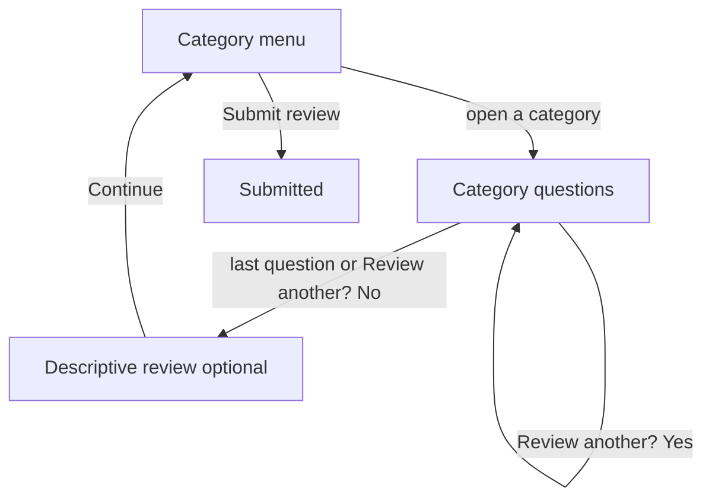

# Primary-user contribute flow

Wheelchair user path for contributing a place review. The same sequence runs on iOS and Android. Secondary users (anyone whose mobility profile is not Wheelchair) walk the same screens. Eight questions use third-person wording; every option and skip stays the same. The submission records `persona` as `wheelchair` or `secondary`.

Update this file in the same change whenever the contribute form flow changes (steps, skips, questions, or options).

Step order lives in `Mobile/shared/src/commonMain/kotlin/app/rollspot/shared/reviews/ContributeFlow.kt`. iOS mirrors it in `ContributeReviewFlowView`.

The progress bar is Entrance, Elevator, Toilets, Review. At least one category is required. The contributor opens one category from the menu, finishes it, and returns to the menu. Sections they do not open are skipped. Within a picked section, some answers skip later questions. Every category ends with an optional descriptive review, then the menu. Submit review on the menu sends every completed section.

## 1. Category pick

Question: **Help make every visit easier.**

Subtitle: Fill in at least one facility to help others know what to expect.

Categories, in menu order:

- Entrance
- Elevators
- Toilet
- Outdoor Pathways
- Seating
- Parking

Submit review stays off until one category is complete. It sends the review. There is no separate final screen.

## 2. Entrance

Shown only when Entrance is selected. Lobby is asked before Basement when both are selected. After that walk, the contributor can review another entrance. Yes starts again at the photo screen. No opens the descriptive review, and Continue there returns to the menu.

| Screen | Question | Continues when |
| --- | --- | --- |
| Photo | Take or upload a photo (optional) | Always |
| Locations | Where can you find the accessible entrances? Multiple places | At least one of Lobby or Basement |
| Tags | What does the lobby have? or What does the basement have? Multiple answers | At least one tag |
| Ramp | Could you push your wheelchair up the ramp without help? | Only if that location's tags include RAMP. One answer |
| Handrail | Could you reach and grip the handrail from your wheelchair? | Only if that location's tags include HANDRAIL. One answer |
| Another | Review another entrance? | Yes or No. Tapping the choice moves on. There is no Continue button |

Lobby tags: RAMP, HANDRAIL, AUTOMATIC DOORS, MANUAL DOORS, SECURITY ASSISTANCE, WHEELCHAIRS AVAILABLE.

Basement tags: ELEVATOR, DISABLED PARKING, RAMP, HANDRAIL, SECURITY ASSISTANCE.

Ramp answers: Yes, With a push, Too steep, Not sure.

Handrail answers: Yes, With effort, No, Not sure.

Ramp and handrail play a looping video. The info button explains slope and landing (ramps) or height and grip (handrails). Choosing Not sure reveals an optional photo box.

Other tags only record that the thing is present. They do not add a screen.

Going back from a restarted photo screen, before anything new is entered, returns to Review another entrance? for the pass just saved. Each saved entrance is its own pass, with its own photo screen and its own points.

## 3. Elevator

Shown only when Elevators is selected. The contributor can review more than one elevator. Each pass is photo, questions, then location. Yes on the last question starts a blank pass. No opens the descriptive review, and Continue there returns to the menu.

| Screen | Question | Continues when |
| --- | --- | --- |
| Photo | Take or upload a photo (optional). Title: Elevator | Always |
| Entrance width | Could you enter the elevator? | One of Yes, No, Not Sure |
| Space to maneuver | Could you turn your wheelchair freely inside? | Skipped when entrance width is No |
| Reachable buttons | Could you reach the control buttons from your wheelchair? | Skipped when entrance width is No |
| Location | Where is the elevator located? (optional) | Always |
| Another | Review another elevator? | Yes or No. Tapping the choice moves on. There is no Continue button |

The three questions use looping videos:

- Entrance width: wide-entrance video. Info sheet **Elevator Entrance** (Width, Level Threshold).
- Space to maneuver: toilet space video. Info sheet **Space to Maneuver**: enough room to enter and turn a full circle without hitting the walls.
- Reachable buttons: buttons video. Info sheet **Control Buttons** (Height, Emergency).

On iOS, Not Sure on a question reveals an optional photo box.

Going back from a restarted photo screen, before anything new is entered, returns to Review another elevator? for the pass just saved.

Each elevator is its own pass: section photos, the answers, the optional location, and any "Not sure" evidence photos. The place grade uses the most accessible pass.

## 4. Accessible toilets

Shown only when Toilet is selected. The contributor can review more than one toilet. Each pass is photo, questions, then location. Yes on the last question starts a blank pass. No opens the descriptive review, and Continue there returns to the menu.

| Screen | Question | Continues when |
| --- | --- | --- |
| Photo | Take or upload a photo (optional). Title: Accessible Toilets | Always |
| Door | What kind of door does the toilet have? | Manual, Sliding, or Automatic |
| Seat | Is the toilet seat easy to transfer to from your wheelchair? | Yes, Too low, Too high, Not sure |
| Grab bars | Are the grab bars within reach of the toilet? | Yes, Positioned awkwardly, No, Not sure |
| Space | Could you turn your wheelchair freely inside? | Yes, No, Not sure |
| Sink | Could you reach the sink? | Yes, No, Not sure |
| Emergency | Could you reach the emergency aid from your wheelchair or fallen position? | Yes, No, Not sure, There is no emergency button |
| Location | Where is the accessible toilet? (optional) | Always |
| Another | Review another accessible toilet? | Yes or No. Tapping the choice moves on. There is no Continue button |

Door, seat, grab bars, space, and sink play a looping video. Emergency shows a still image. The info button explains each one:

- Door: doors video. Info sheet **Doors** (Manual, Sliding/Automatic).
- Seat: toilet seat video. Info sheet **Toilet Seat** (Height).
- Grab bars: grab bars video. Info sheet **Grab Bars** (Height, Placement).
- Space: space-to-maneuver video. Info sheet **Space to Maneuver**: enough room to enter, close the door, and turn a full circle without hitting the door, toilet, or sink.
- Sink: sink video. Info sheet **Sink** (Reach, Clearance).
- Emergency: still image of a wall button and a pull cord. Info sheet **Emergency Aid** (Reach).

Choosing Not sure on seat, grab bars, space, sink, or emergency reveals an optional photo box.

Going back from a restarted photo screen, before anything new is entered, returns to Review another accessible toilet? for the pass just saved.

Each toilet is its own pass: section photos, the six answers, the optional location, and any "Not sure" evidence photos. The place grade uses the most accessible pass.

## 5. Supplemental areas

Outdoor Pathways, Seating, and Parking each start with an optional photo screen (up to 5), then one question, then the descriptive review. Pathways stores the selected notices. Seating and parking store yes, no, or not sure. They are posted as their own sections.

## 6. Descriptive review

Each category ends with **Tell us about the {category}.** The note is optional free text. Continue returns to the category menu and marks the section complete. Going back returns to the category's last question. For entrance, elevator, and toilet, that restores the pass just saved onto Review another?

The note is stored with that section (`notes` on the section object, max 4000 characters). A section left in progress stays on the device and is not sent.

## 7. Submit from the menu

Submit review sends every completed section together. A confirmation screen follows.

## Photos

Nothing is uploaded until submit. Each photo is a JPEG kept on the device with a stable file id, then `PUT` to `/v1/media/review-photos/:place/:submissionId/:fileId`, then referenced by the returned URL.

| Kind | Where it is taken | Limit |
| --- | --- | --- |
| Section | "Take or upload a photo" at the start of a pass, and the photo screen for pathways, seating, and parking | 5 per pass |
| Evidence | The box that appears after "Not sure" | 3 per pass, across every question of that pass |

Evidence is kept only while the answer stays "Not sure". Changing the answer deletes those photos. Entrance section photos stay on the pass. They are not copied onto lobby or basement.

## Secondary wording

| Screen | Secondary question |
| --- | --- |
| Ramp | Could someone on a wheelchair go up the ramp without help? |
| Handrail | Could someone in a wheelchair reach and grip the handrail? |
| Elevator entrance | Could someone in a wheelchair enter the elevator? |
| Elevator space | Could someone in a wheelchair turn freely inside? |
| Elevator buttons | Could you reach the control buttons from a seated position? |
| Toilet space | Could someone in a wheelchair turn freely inside? |
| Toilet sink | Can someone in a wheelchair reach the sink faucet comfortably? |
| Toilet emergency | Could you reach the emergency aid from a seated or fallen position? |

Every other question uses the primary wording for both personas.
