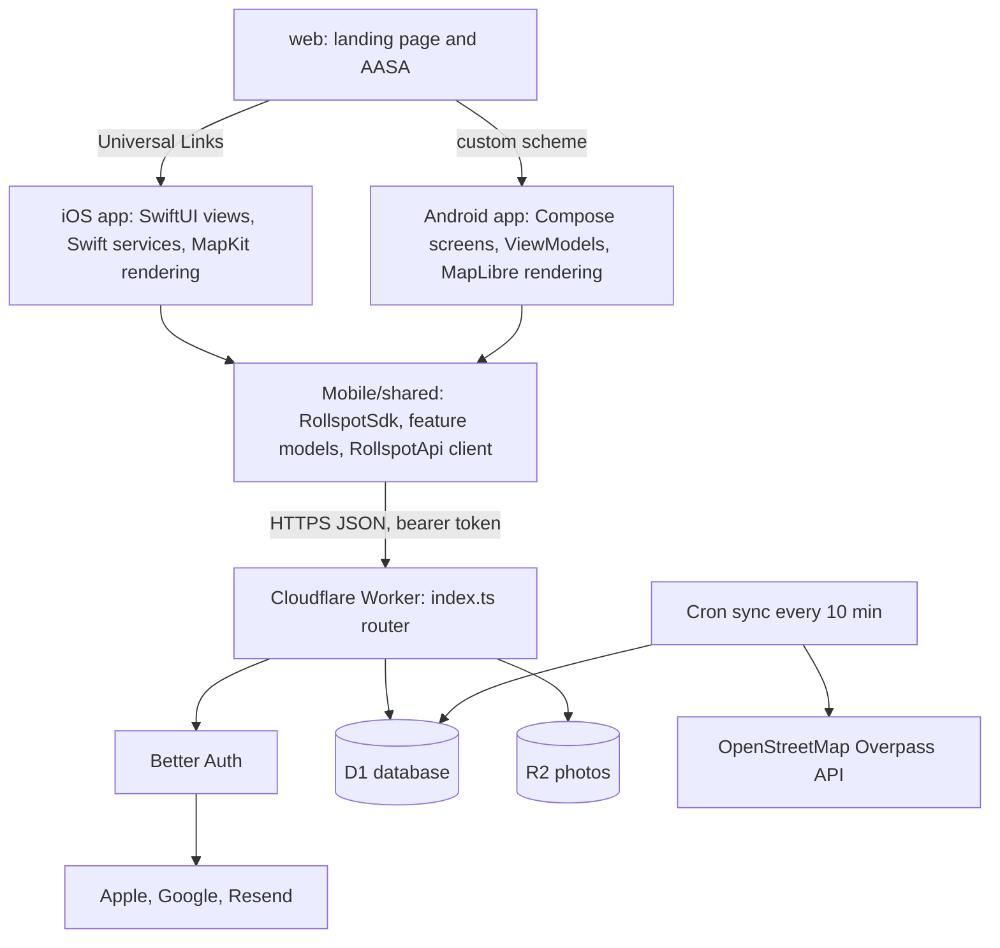
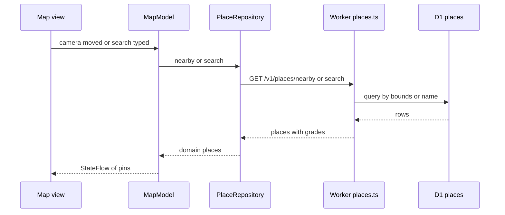

# Rollspot V1.1 architecture

This is the code-level description of Rollspot as it stands in V1.1: the backend, the shared Kotlin module,
the iOS app, the Android app, and how they connect. For maintenance tasks and failure modes, see
[`operations-and-failure-modes.md`](operations-and-failure-modes.md). For the HTTP contract, see
[`backend/API.md`](../backend/API.md).

The complete engineering documentation set starts at [`README.md`](README.md). Detailed system diagrams,
platform implementation, API, data, security, operations, testing, engineering findings, and unresolved
questions are split into linked documents there.

## 1. What V1.1 is

- **One backend:** a Cloudflare Worker with D1 (SQLite), R2 (photos) and Better Auth.
- **One business-logic layer:** a Kotlin Multiplatform module (`Mobile/shared`) used by both apps.
- **Two native UIs:** SwiftUI on iOS and Jetpack Compose on Android. They draw screens and call shared models.
- **One place directory:** places live in Rollspot's own D1 `places` table, built from OpenStreetMap by a
  Worker cron job. The apps get places only from `/v1/places/*`, never from MapKit search, Google Places or
  public OpenStreetMap servers.

## 2. System map



## 3. Backend (`backend/`)

**Entry point:** [`backend/src/index.ts`](../backend/src/index.ts) exports two handlers:

- `fetch`: a hand-written router that maps paths to handler modules and converts errors to JSON.
- `scheduled`: the cron trigger (`*/10 * * * *` in [`wrangler.jsonc`](../backend/wrangler.jsonc)) that runs
  `syncDueTiles`.

**Bindings and services** (configured in `wrangler.jsonc`, typed in [`env.ts`](../backend/src/env.ts)):

| Binding / service | Purpose |
|-------------------|---------|
| `DB` (D1 `rollspot`) | Places, sync state, reviews and their normalized answers, photos metadata, saved places, Better Auth tables |
| `MEDIA` (R2 `rollspot-media`) | Review photo and avatar JPEGs |
| Better Auth | Sessions, email/password, Apple and Google ID-token sign-in, bearer tokens |
| Resend | Verification and password-reset emails |
| Overpass API | Source for the place directory (sync job only) |

**Modules:**

| File | Responsibility |
|------|----------------|
| [`auth.ts`](../backend/src/auth.ts) | Better Auth setup, `requireUserId` helper, Resend email sending |
| [`places.ts`](../backend/src/places.ts) | `/v1/places/nearby`, `/v1/places/search`, `/v1/places/:key` (+ `accessibility`, `photos`), saved places |
| [`reviews.ts`](../backend/src/reviews.ts) | Review list, create, update, delete, my reviews, review photos per place |
| [`contribution.ts`](../backend/src/contribution.ts) | Validation and storage of the version 2 contribute payload (per-section answers and photos) |
| [`media.ts`](../backend/src/media.ts) | JPEG upload to R2 with deterministic keys; public media reads |
| [`profile.ts`](../backend/src/profile.ts) / [`account.ts`](../backend/src/account.ts) | Profile and avatar; account deletion (`DELETE /v1/me`) |
| [`sync.ts`](../backend/src/sync.ts) / [`osm.ts`](../backend/src/osm.ts) | Tiled OpenStreetMap sync and Overpass queries; `POST /v1/admin/sync-places` |
| [`http.ts`](../backend/src/http.ts) | JSON responses, `HttpError`, body parsing |

**Route groups** (full contract in [`backend/API.md`](../backend/API.md)):

| Path | Auth | Purpose |
|------|------|---------|
| `/api/auth/*` | varies | Better Auth endpoints (sign-up, sign-in, social, verify email) |
| `/v1/auth/email-registered`, `/v1/auth/providers` | public / bearer | Sign-in flow helpers |
| `/v1/places/nearby`, `/v1/places/search`, `/v1/places/:key/...` | public | Place directory and per-place grades, photos, reviews |
| `/v1/reviews`, `/v1/reviews/:id`, `/v1/me/reviews` | bearer for writes | Contributions |
| `/v1/media/review-photos/:place/:submission/:file` | bearer | Photo upload (PUT) |
| `/v1/media/:key` | public | Photo read |
| `/v1/profile/*`, `/v1/saved-places/*`, `/v1/me` | bearer | Profile, bookmarks, account deletion |
| `/v1/admin/sync-places` | `ADMIN_TOKEN` | Manual place sync |
| `/health` | public | Liveness |

**Place sync.** Regions (Bali is active) are split into 1-degree tiles in `sync_tiles`. Each cron run syncs
up to 10 of the most overdue tiles, pausing between Overpass calls. A tile's first sync is a full load;
later syncs fetch only changes. Tiles with places are revisited after 7 days, empty tiles after 28. Places
are upserted by OpenStreetMap reference, so Rollspot place IDs stay stable.

**Migrations:** [`backend/migrations/`](../backend/migrations/) `0001_initial` to `0005_incremental_sync`.

## 4. Shared module (`Mobile/shared`)

**Rule:** if it is an `if`, a network call or a validation rule, it belongs here. Views read `StateFlow`
state from a shared model and send user actions to it.

**Composition root:** [`RollspotSdk.kt`](../Mobile/shared/src/commonMain/kotlin/app/rollspot/shared/RollspotSdk.kt).
Each app creates one instance at launch with the API base URL and a platform `TokenStore`. It owns the API
client and every feature model, and clears per-user models (saved places, profile, my reviews) when the
session changes.

| Package | Key types | Responsibility |
|---------|-----------|----------------|
| `api` | `RollspotApi`, `Dto`, `ApiException` | Ktor HTTP client, request/response models, bearer header, GET retry, retryable-error classification |
| `auth` | `AuthModel`, `AuthRules`, `TokenStore` | Sign-in/up state machine, validation, session restore, sign-out, delete account |
| `places` | `PlaceRepository`, `Accessibility`, `Distance` | Nearby/search/detail calls, grade collapse rules, OpenStreetMap attribution |
| `map` | `MapModel`, `MapPins`, `PlaceSearchProvider` | Map state: visible pins, filters, search results |
| `place` | `PlaceDetailModel`, `FacilityReview` | One place page: details, grades, reviews, photos |
| `reviews` | `ContributeFlow`, `ReviewModel`, `ContributeSubmission`, `ReviewSubmissionPhotos` | Contribute wizard steps and rules, payload assembly, photo-then-review upload with stable `submissionId` |
| `profile` | `ProfileModel`, `MyReviewsModel` | Profile, avatar, the user's own reviews |
| `saved` | `SavedPlacesModel` | Bookmarks with optimistic updates |
| `util` | `Concurrency` | In-flight guards for mutations |

Platform code in the module is limited to `androidMain/.../AndroidTokenStore.kt`; iOS supplies its token
store from Swift.

**Build and delivery:**

- **Android:** the app depends on `project(":shared")` directly.
- **iOS:** Gradle builds a static framework named `Shared`. The Xcode build phase runs
  [`Mobile/scripts/build-shared-for-xcode.sh`](../Mobile/scripts/build-shared-for-xcode.sh) first. SKIE turns
  Kotlin `suspend` functions into Swift `async` and `Flow` into `AsyncSequence`.
- **Tests:** `commonTest` covers api, auth, map, place, places, profile and reviews
  (`./gradlew :shared:testDebugUnitTest :shared:iosSimulatorArm64Test`).

## 5. iOS app (`Mobile/Rollspot`)

**Entry:** [`App/RollspotApp.swift`](../Mobile/Rollspot/App/RollspotApp.swift) shows
`Views/ContentView.swift`. [`App/DeepLinkRouter.swift`](../Mobile/Rollspot/App/DeepLinkRouter.swift) handles
Universal Links (`/place*`) and the `puspadifellas://place` and `puspadi://auth/callback` schemes.

**Connection to shared:** [`Services/RollspotServices.swift`](../Mobile/Rollspot/Services/RollspotServices.swift)
creates the single `RollspotSdk` with `CloudflareConfig.apiBaseURL` and a `KeychainTokenStore`. Swift
services and stores wrap shared models for SwiftUI:

| Swift type | Wraps |
|------------|-------|
| `MapStore`, `NearbyPlacesService` | `MapModel`, `PlaceRepository` (MapKit only draws) |
| `AuthSessionStore` | `AuthModel`; also runs Sign in with Apple and Google Sign-In to get ID tokens |
| `ReviewService`, `ReviewSubmissionBridge`, `ContributeFlowBridge` | `ReviewModel`, `ContributeFlow` |
| `PlaceReviewStore`, `PlacePhotoService` | `PlaceDetailModel` |
| `ProfileService`, `SavedPlacesService` | `ProfileModel`, `MyReviewsModel`, `SavedPlacesModel` |

**Native-only responsibilities:** SwiftUI screens, MapKit map rendering, location permission
(`LocationManager`), camera and photo picker, speech-to-text for review notes (`SpeechRecognizer`), image
caching (`ImageStore`), and the local unfinished-review snapshot (`UnfinishedReviewStore`).

**Feature folders (`Views/`):** `Splash`, `Home` (map and search), `Detail` and `Facilities Details`
(place page), `Review` and `Contribute` (contribute wizard), `Photos` and `Gallery`, `Auth`, `Profile`,
`Saved`, `Analysing`.

**Configuration:** bundle ID `com.puspadifellas.app`, team `7HU54XPQ85`, iOS 18 minimum. The API base URL
comes from `ROLLSPOT_API_BASE_URL` (debug override via scheme environment variable).

## 6. Android app (`Mobile/android`)

**Entry:** [`RollspotApplication.kt`](../Mobile/android/app/src/main/java/com/rollspot/app/RollspotApplication.kt)
creates `RollspotSdk(BuildConfig.API_BASE_URL, AndroidTokenStore(this))` and restores the session.
`MainActivity.kt` receives deep links and hosts `ui/RollspotApp.kt` (Compose navigation).
`ui/RollspotSdkProvider.kt` exposes the SDK to screens.

**Connection to shared:** each screen has a thin Android `ViewModel` that holds the shared model and exposes
its `StateFlow`:

| Screen package | ViewModel | Shared model |
|----------------|-----------|--------------|
| `ui/screens/home` | `HomeViewModel` | `MapModel` |
| `ui/screens/place` | `PlaceDetailViewModel` | `PlaceDetailModel` |
| `ui/screens/contribute` | `ContributeFlowViewModel`, `ReviewViewModel` | `ContributeFlow`, `ReviewModel` |
| `ui/screens/auth` | `AuthViewModel` | `AuthModel` |
| `ui/screens/profile` | (screen-level) | `ProfileModel`, `MyReviewsModel`, `SavedPlacesModel` |

**Native-only responsibilities:** Compose screens, MapLibre map with OpenFreeMap tiles
(`ui/components/PinMap.kt`), location (`data/LocationService.kt`), Google sign-in through Credential Manager
(`ui/screens/auth/GoogleSignIn.kt`), photo picker and JPEG encoding (`PhotoEncoding.kt`).

**Configuration:** application ID `com.rollspot.app`. The API base URL comes from `rollspot.apiBaseUrl` in
`Mobile/local.properties`, and the Google web client ID from `rollspot.googleWebClientId`.

## 7. How the components work together

### Finding places



MapKit (iOS) and MapLibre (Android) only render the pins they are given.

### Signing in

1. The native button (Apple or Google) returns an ID token, or the user types email and password.
2. `AuthModel` validates input and calls Better Auth (`/api/auth/*`) through `RollspotApi`.
3. The Worker returns a bearer token. `TokenStore` saves it (Keychain on iOS, Android Keystore-backed
   storage on Android).
4. `RollspotApi` attaches the token to every request. A `401` clears it and the session becomes signed out.
5. Email sign-up sends a verification link through Resend that opens `puspadi://auth/callback` in the app.

### Contributing a review

1. `ContributeFlow` drives the wizard: which section is next, which answers are required, when submit is
   allowed. Views only render the current step.
2. On submit, `ReviewModel` assigns a stable `submissionId`, uploads each JPEG with
   `PUT /v1/media/review-photos/...` (deterministic keys, so retries overwrite rather than duplicate), then
   sends `POST /v1/reviews`.
3. D1 enforces one review per `(user_id, submission_id)`, so a retried submit returns the existing review.
4. The review also writes the contributor's per-feature signal to `accessibility_signals` (one current signal
   per user, place and feature). Place reads compute grades from those signals, so the next place page load
   shows the update.

### Shared links

- Share URLs point to the website (`puspadi-fellas.pages.dev/place?...`).
- iOS: [`web/.well-known/apple-app-site-association`](../web/.well-known/apple-app-site-association) declares
  `/place*` for `7HU54XPQ85.com.puspadifellas.app`, so the link opens the app directly.
- Android: no verified https App Links yet. [`web/place/index.html`](../web/place/index.html) offers an
  "Open app" button using the `puspadifellas://place` scheme.

### Place directory refresh

The cron job writes to the same `places` table that `/v1/places/*` reads. The apps are never involved, and a
slow Overpass API delays updates but not user requests.

## 8. Repository layout

```
backend/            Cloudflare Worker (src/), D1 migrations, wrangler.jsonc, API.md
Mobile/shared/      Kotlin Multiplatform business logic and tests
Mobile/Rollspot/    iOS app (App/, Services/, Views/, Models/, Config/)
Mobile/android/     Android app (app/src/main/java/com/rollspot/app)
Mobile/scripts/     build-shared-for-xcode.sh and asset sync
web/                Landing page, place link page, AASA, _headers
docs/               Specs, contribute flow, operations, this document
```

## 9. Known gaps in V1.1

- **Google Sign-In on iOS** is not configured: `GOOGLE_IOS_CLIENT_ID` in `Mobile/Info.plist` is still a
  placeholder.
- **Android https links:** shared https links open the browser on Android; only custom schemes reach the app.
- **Legacy iOS client:** `CloudflareAPIClient` and `AccessibilityService` predate the shared module and are no
  longer used for live calls. They can be removed.
- **AI place summary:** `PlaceAISummaryService` shows nothing until the backend adds a summary endpoint.
- **Stale docs:** the root `README.md` and `docs/specs.md` still describe MapKit-sourced places, and
  `backend/API.md` says the cron runs on Mondays (it runs every 10 minutes).
